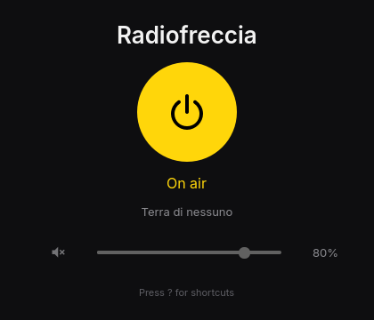

# Freccia



Radiofreccia on and off, from the Omarchy bar, a small window, or the
terminal. One click on the radio icon in the bar starts the station; another
stops it. The show on air and the song playing appear in the window and the
bar's tooltip.

## Install

```sh
bin/install          # builds the package and installs it with makepkg -fsi
freccia bar install  # puts the radio button on the Omarchy bar
```

Freccia then shows up in the app launcher (`Super + Space`).

## The bar button

| Action      | Does                              |
|-------------|-----------------------------------|
| Click       | Switch the radio on or off        |
| Right-click | Open the window                   |
| Scroll      | Volume up or down                 |

The icon lights in the theme's accent while the radio plays and dims while
it connects. `freccia bar remove` takes it off again.

## Shortcuts

| Key     | Does                           |
|---------|--------------------------------|
| Space   | Switch the radio on or off     |
| ↑ ↓     | Volume                         |
| M       | Mute                           |
| Esc     | Hide the window, keep playing  |
| Q       | Quit and stop the radio        |
| ?       | Show or hide shortcuts         |

## Command line

```sh
freccia toggle | play | stop
freccia status [--json]
freccia volume 60 | +5 | -5
freccia quit
```

Each command exits 0 on success and 1 with a message on stderr otherwise.
`--json` prints the status as one JSON object.

## How it works

One `freccia` process plays the stream with Qt Multimedia. The window, the
bar, and the command line reach it through a socket in
`$XDG_RUNTIME_DIR/freccia/`, and it writes its status to `state.json` beside
it, which the bar widget watches. Closing the window leaves the radio
playing; switching the radio off with no window open ends the process.

The station address can be changed with `stream=` in
`~/.config/freccia/freccia.conf`, which also remembers the volume.

## Development

```sh
bin/build   # build/freccia
bin/test    # Qt tests offscreen, plus the bar widget's logic in Node
```
